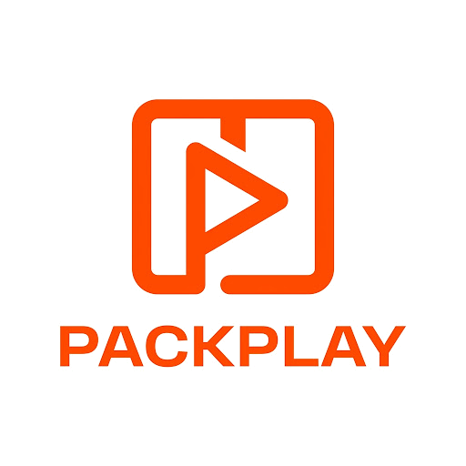

# PackPlay 🎒

> Smart, real-time equipment coordination and packing readiness for outdoor trips, expeditions, and sports teams.

<p align="center">
  
</p>

<p align="center">
  
  
  
  
  
</p>

---

## 🌟 What is PackPlay?

Organizing group gear before a trek, climbing trip, or sports match can be chaotic: people double up on heavy stoves while forgetting medical kits. 

**PackPlay** solves this by providing:
- 📋 **Reusable Checklists & Profiles**: Sport-specific templates (hiking, climbing, cycling, skiing).
- 🤝 **Shared Equipment Pooling**: Distribute group gear with clear quantity quotas and weight tracking.
- ⚡ **Live Collaborative Packing**: Real-time Socket.IO synchronization and item takeover alerts.
- 🌤️ **Weather-Aware Recommendations**: Smart packing suggestions powered by Open-Meteo forecasts.
- 🧊 **Interactive 3D Item Viewer**: Three.js item inspection directly in your browser.
- 📱 **Mobile-First Responsive Web**: Accessible UI tailored for quick field checkoffs.

---

## 🛠️ Tech Stack

| Layer | Technologies |
|---|---|
| **Backend** | NestJS 11, TypeScript, Socket.IO, Passport JWT, Swagger |
| **Frontend** | React 18, Vite, Tailwind CSS, Lucide Icons, Three.js |
| **Database & Cache** | MySQL 8.0, Prisma ORM, Redis 7 (ioredis) |
| **Monorepo & Build** | Nx 20, Docker Compose |
| **Testing** | Jest, Vitest, Playwright, Supertest |

---

## 🚀 Quickstart (One Command)

The fastest way to run the complete PackPlay stack (MySQL, Redis, Migrations, Backend API, and Web UI) is via Docker Compose:

### 1. Prerequisites
- [Docker Desktop](https://www.docker.com/products/docker-desktop/) (Docker Compose v2+)
- [Git](https://git-scm.com/)

### 2. Launch
```bash
# 1. Clone repository
git clone https://github.com/Nister37/PackPlay.git
cd PackPlay

# 2. Configure local environment
cp .env.example .env

# 3. Start all services
docker compose up -d
```

### 3. Open your browser
- 🌐 **Web Application**: [http://localhost:4200](http://localhost:4200)
- 🔌 **Backend REST API**: [http://localhost:3000](http://localhost:3000)
- 📖 **Interactive Swagger UI**: [http://localhost:3000/api/docs](http://localhost:3000/api/docs)

---

## 💻 Local Development Setup

If you prefer running services directly on your host machine:

### 1. Install Dependencies
```bash
# Install monorepo and API dependencies
npm install

# Install Frontend dependencies
npm --prefix apps/web install
```

### 2. Configure Environment & Database
```bash
# Copy example env
cp .env.example .env

# Start backing services (MySQL 8 + Redis 7)
docker compose up mysql redis -d

# Generate Prisma Client & apply database migrations
npm run prisma:generate
npx prisma db push
```

### 3. Start Development Servers
```bash
# Terminal 1: Start Backend API (Port 3000)
npm run start

# Terminal 2: Start Web UI (Port 5173 / 4200)
npm --prefix apps/web run dev
```

---

## 🧪 Testing

PackPlay features comprehensive automated test coverage:

```bash
# Run backend unit tests (46 test suites, 290+ tests)
npm test

# Run frontend tests (Vitest + Testing Library)
npm --prefix apps/web test

# Check code formatting & linting
npm run lint
```

---

## 📚 Deep Dive Documentation

For advanced topics, see the dedicated guides in `/docs`:
- 🏗️ **Architecture & Domain Design**: [docs/ARCHITECTURE.md](docs/ARCHITECTURE.md)
- ⚙️ **Detailed Setup & Cloud Deployment**: [docs/SETUP.md](docs/SETUP.md)
- 📜 **OpenAPI Contract Specification**: [docs/OPENAPI.md](docs/OPENAPI.md) and [openapi.json](openapi.json)
- 🔒 **Security & Performance Audit**: [docs/SECURITY_PERFORMANCE_AUDIT.md](docs/SECURITY_PERFORMANCE_AUDIT.md)
- 📅 **Calendar Feed Synchronization**: [docs/CALENDAR_IMPORTS.md](docs/CALENDAR_IMPORTS.md)
- 🚀 **CI/CD Pipeline**: [docs/CICD.md](docs/CICD.md)
